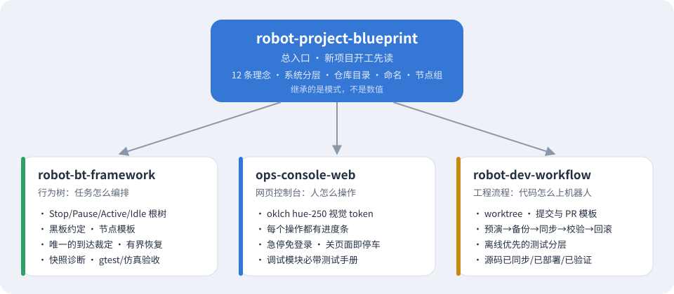
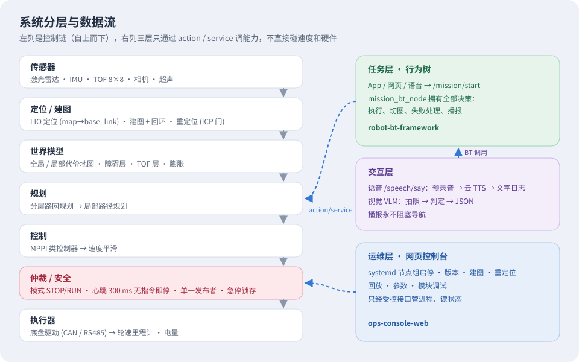
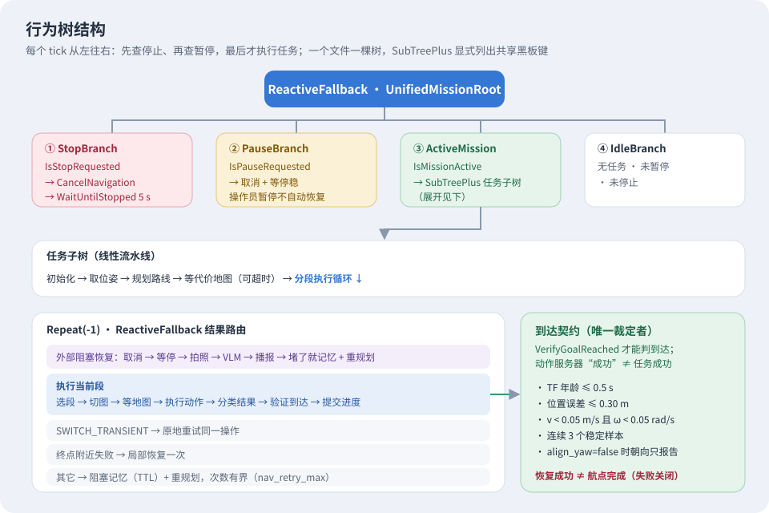
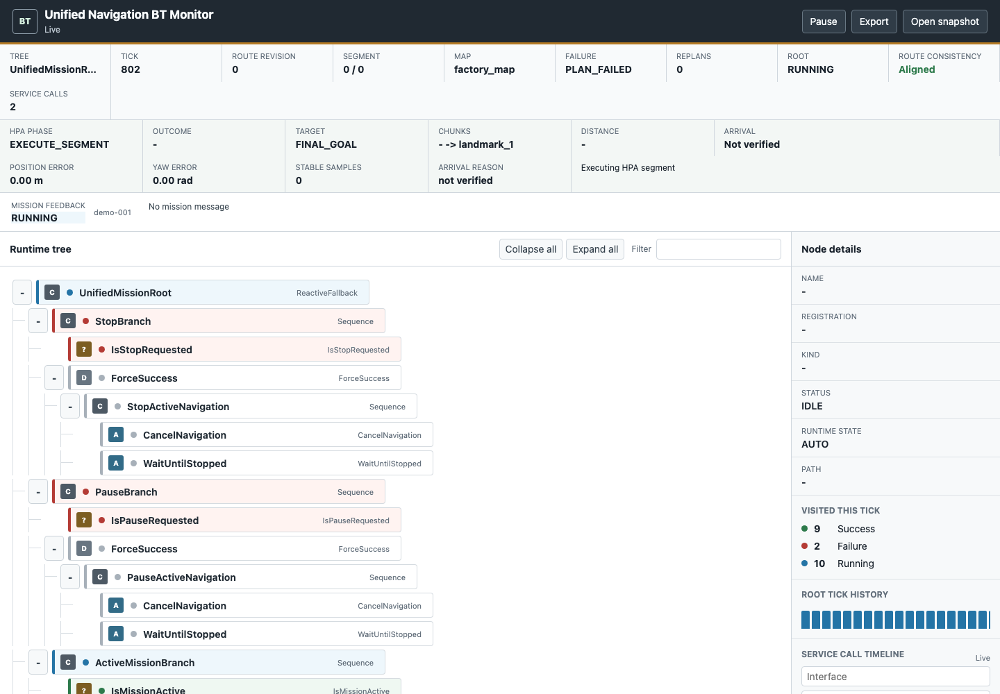
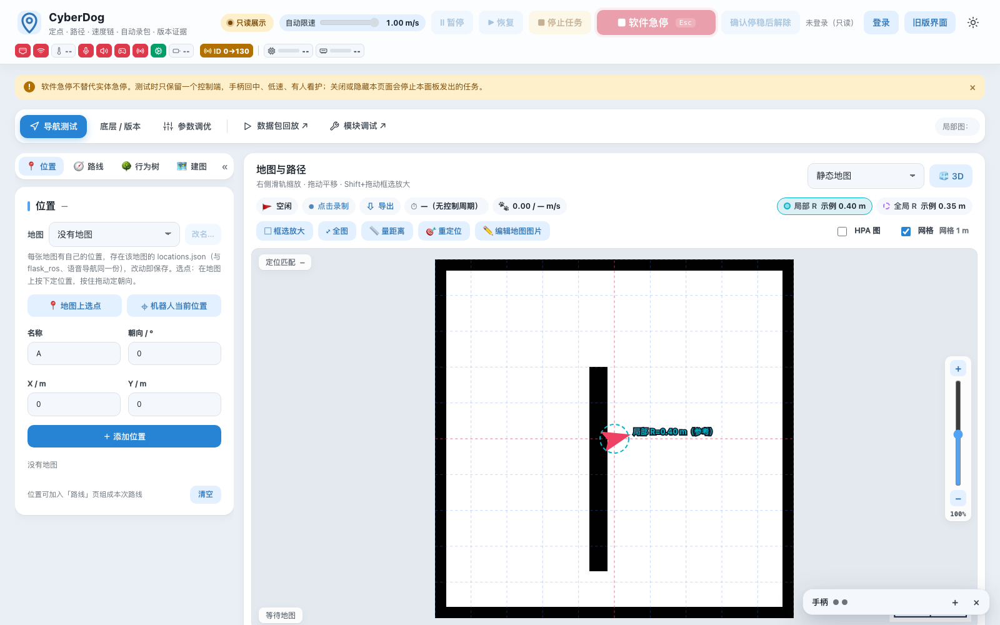
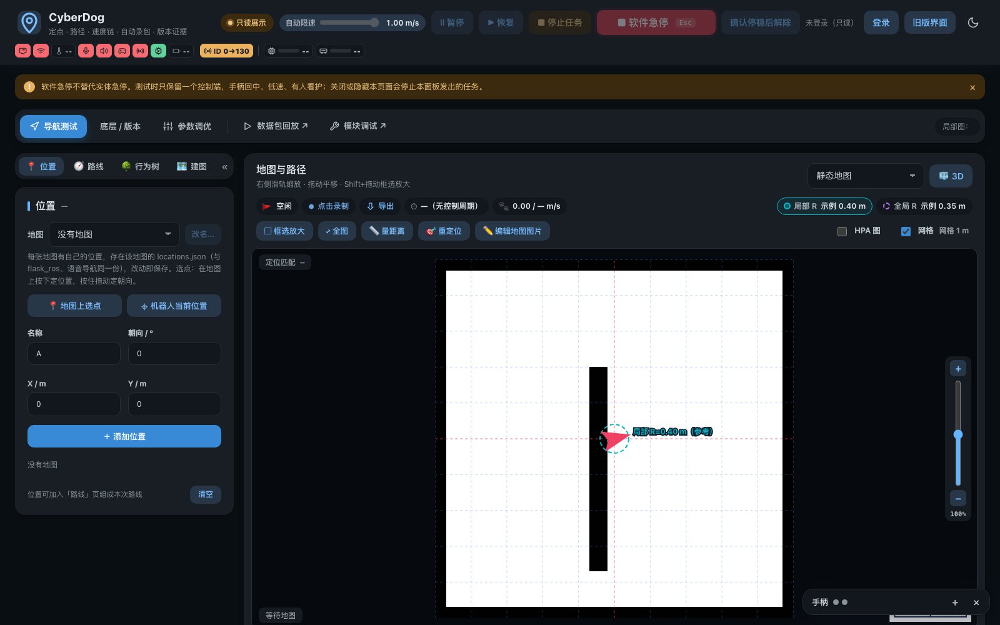
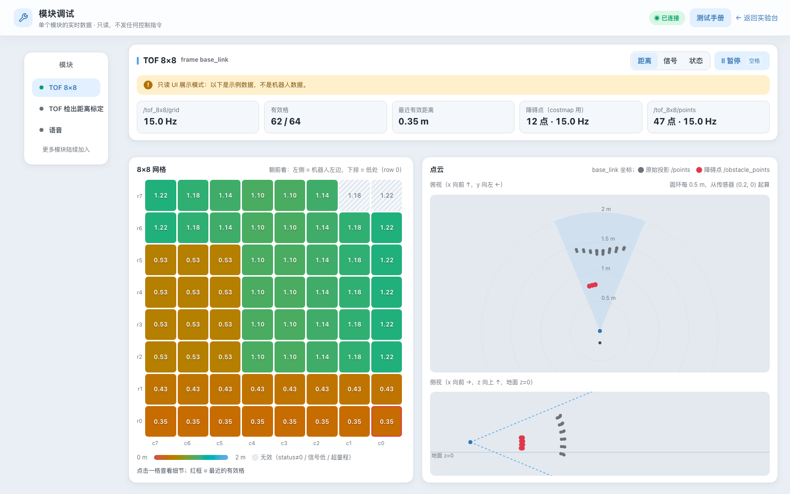
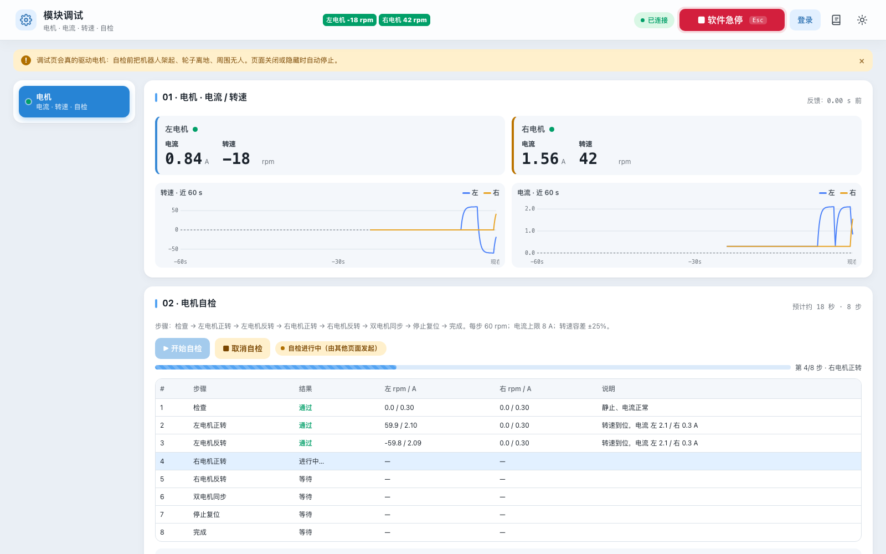
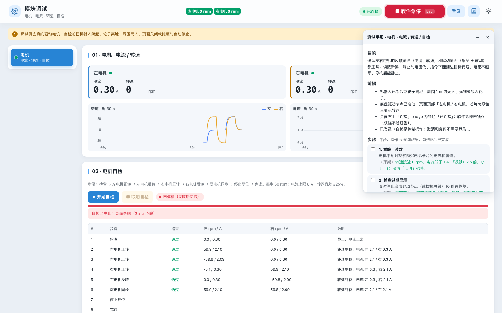
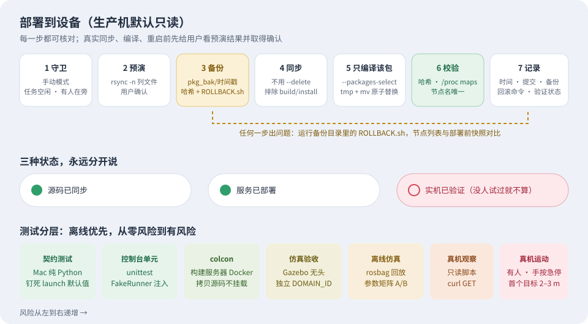

# Robot Project Template Skills

把 Cyber Guide Dog（ROS 2 导盲机器人）整理成项目范本，打包成 4 个 Claude Code 技能。之后的新项目都按这里的模式来做。



| 技能 | 一句话 | 什么时候用 |
|---|---|---|
| [`robot-project-blueprint`](skills/robot-project-blueprint/SKILL.md) | 总入口：设计理念、系统分层、仓库目录、命名 | 新项目开工、规划架构 |
| [`robot-bt-framework`](skills/robot-bt-framework/SKILL.md) | 行为树：任务怎么编排 | 写任务流程、BT 节点、恢复策略 |
| [`ops-console-web`](skills/ops-console-web/SKILL.md) | 网页控制台：人怎么操作 | 做控制台、调试页、回放页、参数页 |
| [`robot-dev-workflow`](skills/robot-dev-workflow/SKILL.md) | 工程流程：代码怎么上机器人 | 分支/提交/PR、部署到设备、测试、写记录 |

**继承的是模式，不是数值。** 技能里出现的端口、话题名、DOMAIN_ID、主机别名、目录都是范本项目的实例，新项目要重新定，没定的写成 `<待定>`。

---

## 1. robot-project-blueprint · 总蓝图



左边是控制链，从传感器一路到执行器，每层只依赖上一层。右边三层（行为树、语音/视觉、网页控制台）只通过 action / service 调用能力，**不直接发速度、不直接碰硬件**。真正能让轮子动起来的只有“仲裁 / 安全”这一层：模式开关、300 ms 无指令即停的心跳、单一发布者检查、急停锁存都在这里。

技能里写了 12 条设计理念，最核心的几条：

- **单一决策者**：行为树拥有所有任务决策，规划器、控制器、语音、视觉只提供能力。
- **失败关闭**：拿不准就停；恢复成功不等于任务成功。
- **处处超时**：每个等待都有超时，每条控制链都有心跳。
- **诚实**：未知显示 `—`，过期标“旧值”，源码 / 部署 / 实机验证三种状态分开说。

另外还有仓库目录模板、话题命名规则（按子系统分根命名空间）、systemd 节点组（每组一个 service、`Restart=no` 让崩溃被看见、统一由一个 target 拉起）和开工清单。

## 2. robot-bt-framework · 行为树



根节点是 `ReactiveFallback`，四个分支按优先级排列：**停止 → 暂停 → 执行任务 → 空闲**。因为是 reactive，每个 tick 都会先检查停止和暂停，所以执行中途按停止也能立刻生效。

任务子树是一条线性流水线，最后进入分段执行循环。每段执行完先**分类结果**，再按类别路由：瞬态问题原地重试，终点附近失败做一次局部恢复，其它情况记下阻塞位置后重新规划，重试次数有上限。

右下角的**到达契约**是这个框架最重要的约定：只有 `VerifyGoalReached` 这一个节点能判定“到了”，而且要满足位置、速度、TF 新鲜度和连续稳定样本。导航动作服务器返回成功，不等于任务成功。

运行时，树的状态以 JSON 快照发布，只读监控页可以实时看到每个节点在干什么（下图是范本项目的监控页，正在执行分段导航）：



技能附带范本项目的 4 棵真实 XML 树、条件节点和异步 action 节点的 C++ 源码，以及测试分层（纯逻辑 gtest → 节点 gtest → 加载真实插件和 XML 的工厂测试 → launch 契约测试 → 仿真验收）。

## 3. ops-console-web · 网页控制台

控制台是现场操作员的仪器，不是营销页面：信息密、状态诚实、每个动作看得见进度、急停永远可用。



从上往下看这张截图，就是技能里规定的页面骨架：

- **顶栏**：品牌、硬件状态芯片（网络、温度、麦克风、雷达、底盘、电量……红色 = 离线）、自动限速滑块，以及暂停 / 恢复 / 停止任务 / **软件急停（Esc）**。
- **琥珀色提示条**：安全提醒，可以用 × 关掉；急停时变红，而且不能关。
- **胶囊导航**：主页的几个标签 + 新标签页打开的“数据包回放 ↗”“模块调试 ↗”。
- **左侧可折叠侧栏 + 右侧地图面板**：标题前那根主色竖条、白色圆角卡片、浅色底，都来自技能里的 oklch hue-250 颜色变量。

同一套变量自动生成深色主题，不用另写一套样式：

| 浅色 | 深色 |
|---|---|
|  |  |

每个硬件模块都有自己的只读调试页，例如 TOF 8×8 传感器（左侧模块列表 + 统计卡片 + 实时网格和点云）：



### 用技能新做的页面长什么样

下面两张图**不是**范本项目里的页面，而是测试时让 Claude 只读技能、从零给新项目做的“电机调试”页（第 2 轮测试产出，用模拟电机运行）。技能里的约定都自动带上了：



- 自检是**后台作业**：接口立刻返回，页面轮询进度，进度条显示“第 4/8 步 · 右电机正转”。
- 每一步的实测值和结论都写在表里，未开始的显示“等待”和 `—`，不编造数据。
- 急停按钮常驻右上角，`Esc` 即可触发，并且不需要登录。



- 右上角书本按钮（或按 `h`）打开浮动**测试手册**：目的 → 前提 → 可勾选的操作步骤和预期结果 → 常见问题。
- 截图里的自检被中止了，红条写着“页面失联（3 s 无心跳）”：发起页面停止发心跳后，后端自动停电机并回滚。这就是技能要求的**死人开关**。

技能附带可以直接复制的 `style.css`（颜色变量 + 组件）、`progress.js`（进度条）、`debug-manual.js`（测试手册浮窗）、`auth.py`（登录，急停类接口永远开放）、`runner.py` / `fakes.py`（可注入的外部命令和测试替身）。

## 4. robot-dev-workflow · 工程流程



**部署**分 7 步，生产机默认只读：先确认手动模式、任务空闲、有人在旁；预演列出要改的文件给用户确认；备份到带时间戳的目录并生成回滚脚本；只同步、只编译改动的那个包；用哈希、`/proc/<pid>/maps` 和节点名唯一性校验真正加载的是新代码；最后记录时间、提交、备份位置和回滚命令。

**三种状态永远分开说**：源码已同步、服务已部署、实机已验证。部署了但没人在真机上试过，就写“未验证”。

**测试离线优先**：从 Mac 上的契约测试和单元测试开始，到构建服务器 Docker 里的 colcon，再到无头仿真验收、rosbag 离线仿真，最后才是真机只读观察和有人看护的真机运动。

技能里还有分支和提交规范、PR 模板、计划 / 排障 / 事故 / 部署记录的文档模板，以及项目技能（`skills/`）该怎么写。

---

## 安装

用户级安装（所有项目都能用）：

```bash
git clone git@github.com:Mafumaful/robot-project-template-skills.git
cp -R robot-project-template-skills/skills/* ~/.claude/skills/
```

只给某个项目用：把 `skills/<name>` 复制到该项目的 `.claude/skills/`。

`dist/` 里是同样内容的 `.skill` 打包文件，可以在 Claude 应用里直接安装。

## 测试结果（2026-11-09）

用 3 个新项目任务（送餐机器人骨架、电机调试页、部署脚本 + PR）做了两轮对比测试：

| 轮次 | 用技能 | 不用技能 |
|---|---|---|
| 第 1 轮 | 92% | 57% |
| 第 2 轮（修复后） | 96% | 49% |

测试后的修复：不再照搬范本的具体数值；模板 `auth.py` 改为在创建 `Auth` 时读取 `CONSOLE_DEFAULT_PASSWORD`（原先在导入时读取，导致整套测试依赖执行顺序）。

## 图片来源

- `images/*.svg`：根据技能内容绘制的示意图。
- `console-*.png`、`debug-tof.png`：范本项目的 8090 控制台，在 Mac 上以只读 `--demo` 模式运行截图（数据是示例数据，不是机器人数据）。
- `bt-monitor.png`：范本项目行为树监控页的测试截图。
- `motor-*.png`：第 2 轮测试中，Claude 只读技能生成的电机调试页，用模拟电机运行截图。

## 更新

源项目的做法变了（新的控制台模式、BT 契约调整等）时，改 `skills/` 里对应的文件，重新打包 `dist/`，必要时更新截图，再提交。
